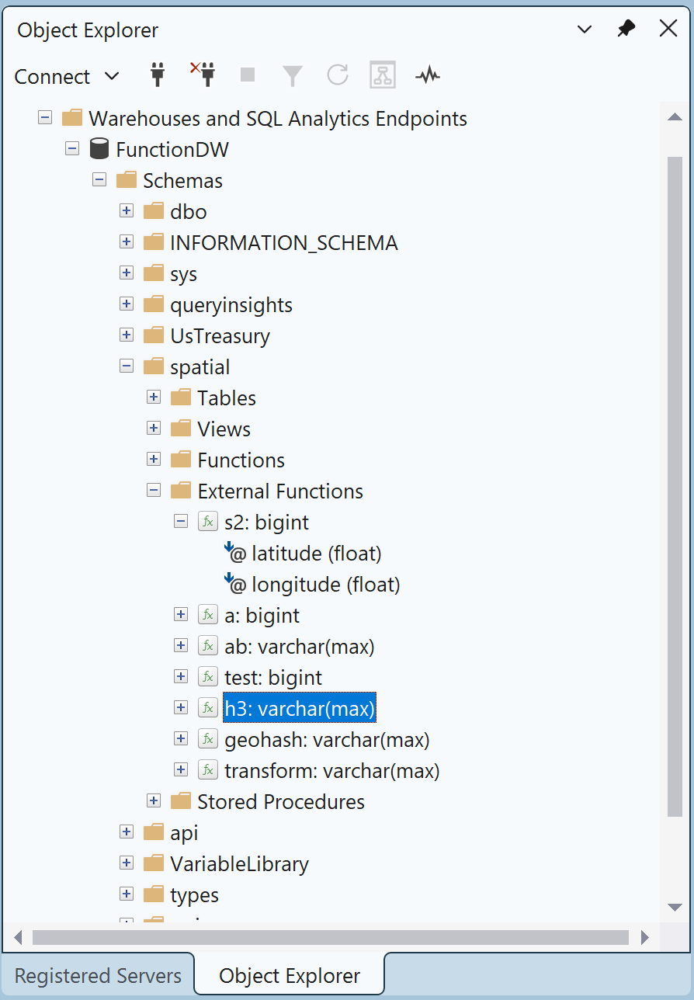
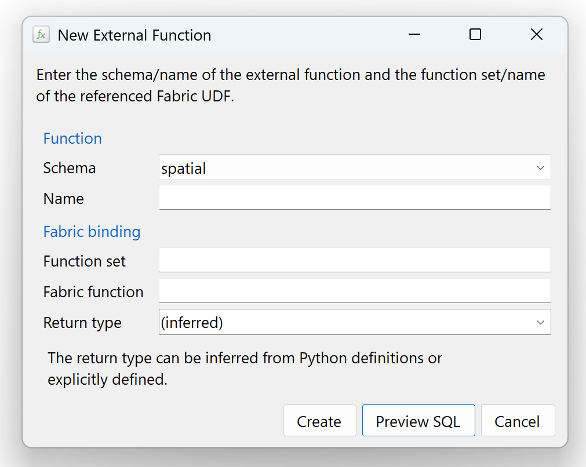
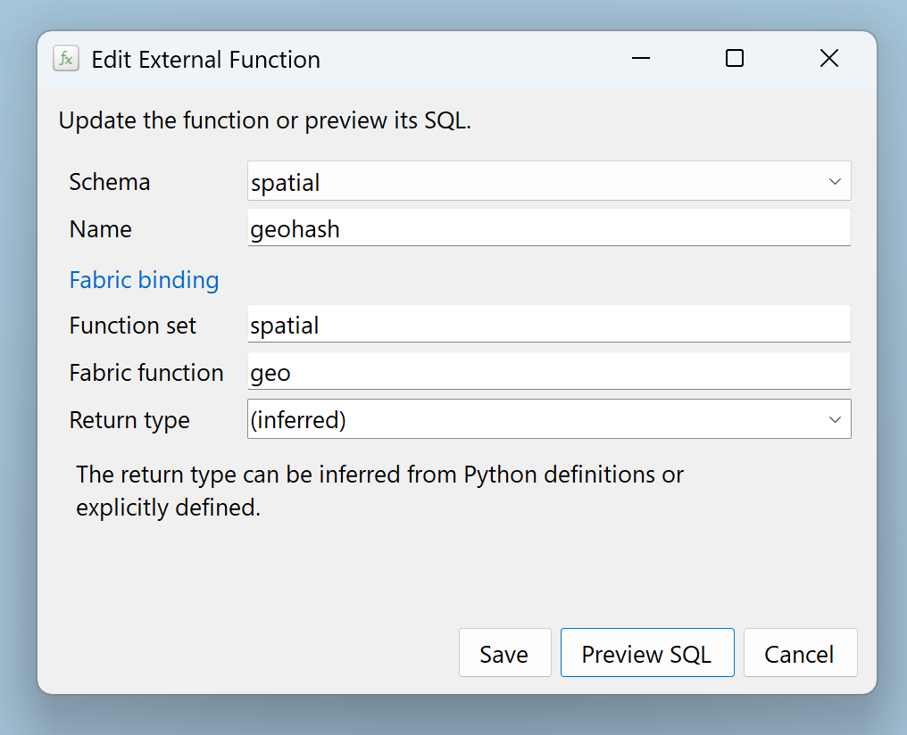
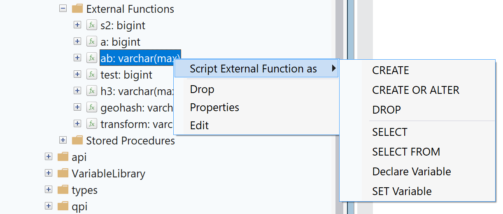

# User guide

Manage Fabric Warehouse T-SQL proxy functions from SSMS Object Explorer: browse
their signatures, create bindings to published Fabric User Data Functions, edit
or clone proxies, and generate SQL. The extension does not publish or edit Python
code.

## Install

Use Windows x64 with separately installed SSMS 22.x.
[Download the 0.1.33 VSIX](https://github.com/jovanpop-msft/ssms-fabric-external-functions/releases/download/v0.1.33/FabricExternalFunctions.vsix),
or [build it from source](development.md#build-and-test).
Installing an existing VSIX does not require the .NET SDK or build commands.

1. Save your work and close SSMS.
2. Double-click `FabricExternalFunctions.vsix` to open the graphical VSIX Installer.
3. Select **SQL Server Management Studio 22** and complete installation.
4. Reopen SSMS and connect Object Explorer to your Fabric Warehouse.

**No PowerShell command is needed for normal installation.** The package is an
unsigned development preview. Follow your organization's extension policy and
do not force installation past compatibility warnings. The installation target
is SSMS 22 x64, not Visual Studio, SSMS 21 or SSMS 23.

### If double-click does not work

If Windows has no VSIX file association, or the installer does not offer SSMS 22,
cancel and open the package with SSMS 22's own `VSIXInstaller.exe`. For a default
installation, this optional PowerShell command opens that graphical installer:

```powershell
$ssmsIde = 'C:\Program Files\Microsoft SQL Server Management Studio 22\Release\Common7\IDE'
& "$ssmsIde\VSIXInstaller.exe" '.\FabricExternalFunctions.vsix'
```

Adjust the installer and package paths to your machine. This is an alternative
way to start the installer, not an extra step after a successful double-click
installation. If SSMS 22 is still unavailable as a target, stop and check the
installed host and package compatibility.

## Browse functions

Connect Object Explorer to a Fabric Warehouse. In schema-based view, expand a
user schema and then **External Functions**. In classic object-type view, the
folder is under **Programmability > Functions**.

Functions display their SQL return type. Expand a function to see its input
parameters in declaration order; functions with no inputs have no children.
Refresh the folder after changes made outside the extension. Browsing and
refreshing read catalog metadata; they never invoke a Fabric function.

The extension excludes system schemas. A missing return type is shown as
unavailable rather than inferred from a name or a local cache.



## Create a proxy

1. Right-click the folder and select **New External Function...**.
2. Choose an existing warehouse **Schema** and enter the SQL **Name**.
3. Enter the **Function set** (the Fabric User Data Functions item name) and
   **Fabric function** (its published function name). These are not a workspace
   name, URL or SQL schema.
4. Leave **Return type** as **(inferred)** to use the Python definition, or select
   or enter an explicit supported SQL type, including size or precision.
5. Choose **Create** to execute, or **Preview SQL** to review the statement.

The warehouse derives inputs from the published Fabric function; this dialog
does not define Python code or a separate SQL parameter list.



For example, a proxy could be declared as follows. The referenced item and
function must already exist and be accessible:

```sql
CREATE FUNCTION [analytics].[score]
AS EXTERNAL FUNCTION [ExampleFunctions].[calculateScore];
```

**New (from template)...** opens the CREATE template in a new warehouse query.
Replace its editable placeholders before executing it yourself.

## Edit, replace or clone

Right-click a function and choose **Edit**. Keeping its schema and name produces
an in-place ALTER. Changing either shows the replacement warning and retention
checkbox.

| Choice after changing schema or name | Effect |
|---|---|
| Retain existing function unchecked | DROP FUNCTION IF EXISTS for the original, then CREATE at the new identity |
| Retain existing function checked | CREATE a clone; leave the original unchanged |

Neither mode copies permissions or redirects existing callers. Replacement is
**not atomic**: if CREATE fails after DROP succeeds, the original is not restored.
Source checks and destination checks reduce conflicts but do not lock out all
concurrent changes. Existing destinations are not intentionally overwritten.

**Save** executes directly. The extension blocks duplicate submission while a
direct operation is pending; it never automatically retries a failed mutation.
Restoring the original schema and name hides and clears retention.



## SQL preview

Preview opens above the existing editor, preserving its fields and selections.

| Action | Result |
|---|---|
| Cancel, Escape or close preview | Return to the editor; execute nothing |
| Apply | Close both dialogs and request execution once, with no second confirmation |
| Open in a new query | On successful export, close both dialogs without executing SQL |
| Copy SQL or Save SQL | Copy or save the text and keep preview open |

Failed export keeps the preview open. An error from preview Apply is reported
in a dialog. Successful changes refresh the affected folders without a success
popup; a refresh error does not mean the completed change should be retried.

## Properties and scripts

**Properties** shows identity and binding information, ordered inputs, the
effective SQL return type and the available stored definition.

**Script External Function as** opens a new query and never executes it:



| Script | Output |
|---|---|
| CREATE | Available stored definition with its leading operation normalized to CREATE |
| CREATE OR ALTER | Available stored definition with its leading operation normalized to CREATE OR ALTER |
| DROP | Independently quoted DROP FUNCTION IF EXISTS |
| SELECT | A function call with type-based input placeholders |
| SELECT FROM | OPENJSON around the call, with schema guidance; available only for catalog varchar(max) returns |
| Declare Variable | A typed variable initialized with the function call |
| SET Variable | A typed variable declaration followed by assignment |

SELECT FROM is intended for JSON-compatible results. A `varchar(max)` return
type does not guarantee valid JSON or a tabular result. Review the generated
comments and supply the appropriate OPENJSON schema before running it.

New queries reuse the selected Object Explorer connection and database through
SSMS. Expired sessions may require authentication. Verify the query connection
before executing; opening a query is not permission to execute its contents.

## Drag a call into a query

Drag a function node into a writable SSMS SQL editor. The inserted call includes
the source warehouse, schema and function; identifiers are quoted when needed.
It does not change the destination query connection.

Arguments follow the catalog's input order. Numeric and bit inputs use `0`,
text/date/time use `''`, Unicode text uses `N''`, binary uses `0x`, uniqueidentifier
uses the zero GUID, JSON uses `'{}'`, and sql_variant uses `NULL`. These are
editable examples, **not declared defaults or guaranteed-valid business values**.
Zero-input calls use `()`. Unsupported or missing types are reported, not guessed.

Dragging inserts text without confirmation or execution. Check its arguments and
destination connection before running it.

## Delete a proxy

Choose **Drop**, review the function and database in **Delete Object**, then
choose **OK**. Cancel makes no changes. The extension checks the current
metadata, executes `DROP FUNCTION IF EXISTS [schema].[name];`, and refreshes the
folder. It does not delete or modify the Fabric User Data Functions item.

The metadata preflight and DROP are not an atomic concurrency lock. Coordinate
with other editors when changing shared objects.

## Validation and recovery

Missing or malformed fields show errors beneath their controls. Correcting a
value clears its error.

Direct Create/Save shows SQL error **31727** beneath **Fabric function** and
**31728** beneath **Function set**, preserving the entered values for correction.
Other direct-action errors, and all preview Apply errors, use a dialog.

After a timeout, connection failure or uncertain mutation result, inspect the
actual warehouse state before retrying. In particular, replacement may have
dropped the original before failing to create the new function.

Missing or truncated catalog definitions cannot establish a verified binding.
CREATE scripting preserves the available stored body; it does not repair an
incomplete definition. Edit may require explicitly confirmed replacement binding
information. Check the generated SQL rather than assuming exported text is
complete or executable.

Refreshing rereads SQL metadata; it does not synchronize a changed Python
signature. Recreating the warehouse proxy may be necessary after remote changes.

## Diagnostics and privacy

Catalog reads and direct DDL use a separate encrypted Microsoft Entra interactive
SQL connection. New-query authentication remains managed by SSMS. The extension
does not extract host passwords or tokens, persist function metadata, or add an
external telemetry service.

SSMS ActivityLog entries can include server/database/schema names, native node
contexts, query hints, function names and exception details. Treat the log as
sensitive. Review and redact it before sharing, including entries from SSMS or
other extensions. Do not include tokens, credentials, connection strings or data.

To capture a log, close SSMS yourself, then run:

```powershell
$ssmsIde = 'C:\Program Files\Microsoft SQL Server Management Studio 22\Release\Common7\IDE'
$logPath = Join-Path $env:TEMP 'FabricExternalFunctions-ActivityLog.xml'
& "$ssmsIde\SSMS.exe" -log $logPath
```

Reproduce the issue and close SSMS to flush the log. Look for **Fabric External
Functions** entries and share only the sanitized details needed to reproduce it.
Never use raw logs as public issue attachments.

## Update or uninstall

Save your work and close SSMS before installing an updated VSIX. Reopen your
normal SSMS installation afterward. Do not enable deprecated loading modes,
modify SSMS policies or force an installer compatibility warning.

To uninstall with the SSMS installer:

```powershell
$ssmsIde = 'C:\Program Files\Microsoft SQL Server Management Studio 22\Release\Common7\IDE'
& "$ssmsIde\VSIXInstaller.exe" '/uninstall:FabricExternalFunctions'
```

Do not delete arbitrary SSMS extension directories or change host configuration.
